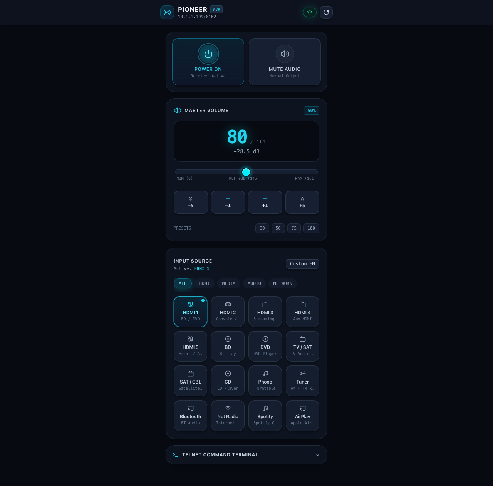
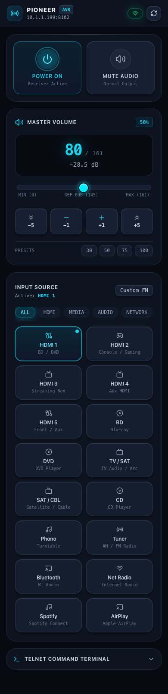
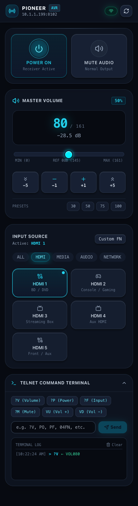

# Pioneer Remote

A browser-based remote for Pioneer AV receivers that support control over Telnet. A React interface provides power, mute, volume, and input controls, backed by a FastAPI server that communicates with the receiver.

## Screenshots

Screenshots show the actual application with simulated receiver data (power on, volume 80, HDMI 1). Available inputs and command support depend on your receiver model.

### Desktop

<p align="center">
  
</p>

### Mobile and command terminal

<div align="center">
<table>
  <tr>
    <th>Mobile remote</th>
    <th>Expanded Telnet terminal</th>
  </tr>
  <tr>
    <td align="center" valign="top"></td>
    <td align="center" valign="top"></td>
  </tr>
</table>
</div>

## Features

- Power and mute toggles with receiver connection indicators.
- Volume slider, fine and coarse adjustments, and quick level presets.
- Input presets grouped by HDMI, media, audio, and network, plus custom input codes.
- Expandable Telnet terminal with common commands and response history.
- Live status updates over WebSocket, with reconnect and fallback polling.
- Responsive dark interface for desktop and mobile browsers.

## Requirements

- A Pioneer receiver with network control enabled and a reachable Telnet control port (default: `8102`).
- A server on a network that can reach the receiver.
- For Docker: Docker with the Compose plugin.
- For local development: Python 3.13+, [uv](https://docs.astral.sh/uv/), and Node.js 20+ with npm.

## Run with Docker

1. Copy the example configuration and edit `.env` to set `PIONEER_IP` to your receiver's IP address. Adjust `PIONEER_PORT` and `PORT` (the published HTTP port) if needed:

   ```sh
   cp .env.example .env
   ```

   Compose automatically reads `.env`. This local file is ignored by Git and excluded from Docker builds; `.env.example` contains sanitized sample values for version control.

2. Build and start the application:

   ```sh
   docker compose up -d --build
   ```

3. Open [http://localhost:8099](http://localhost:8099), or use your server's hostname/IP from another device.

The image builds the frontend and serves it alongside the API on port `8099`.

### Docker network configuration

Choose one of these configurations in `.env` before starting Compose.

For a standalone deployment, keep the example settings:

```dotenv
DEPLOYMENT_NET=
DEPLOYMENT_NET_EXTERNAL=false
```

Compose creates and manages `pioneerremote_default`. If `COMPOSE_PROJECT_NAME` is set, the fallback name is `<COMPOSE_PROJECT_NAME>_default` instead.

To join an existing external network, set both variables:

```dotenv
DEPLOYMENT_NET=my-deployment-network
DEPLOYMENT_NET_EXTERNAL=true
```

Replace `my-deployment-network` with your network's name. The network must exist before starting the application. You can check it with:

```sh
docker network inspect my-deployment-network
```

If you need to create it first, run:

```sh
docker network create my-deployment-network
```

Compose attaches the application to that network without creating or removing it. The service always references the `default` network key in the Compose file; these variables control its actual Docker network name and ownership. Setting only `DEPLOYMENT_NET` with the external flag left `false` creates a managed network with that name.

Validate the configuration after editing `.env`, then apply it:

```sh
docker compose config --quiet
docker compose up -d --build
```

## Run locally

Install dependencies and build the frontend from the repository root:

```sh
uv sync --group dev
cd frontend
npm install
npm run build
cd ..
```

Start the backend, replacing the example address with your receiver's IP:

```sh
PIONEER_IP=192.168.1.100 PIONEER_PORT=8102 uv run python main.py
```

Open [http://localhost:8099](http://localhost:8099). FastAPI serves the UI when `frontend/dist` exists.

For frontend development, keep the backend running and start Vite in a second terminal:

```sh
cd frontend
npm run dev
```

Open [http://localhost:5173](http://localhost:5173). Vite proxies API and WebSocket traffic to the backend on port `8099`.

## Configuration

| Variable | Default | Purpose |
| --- | --- | --- |
| `PIONEER_IP` | `10.1.1.199` | Receiver IP address or hostname. Set this for your network. |
| `PIONEER_PORT` | `8102` | Receiver Telnet control port. |
| `PORT` | `8099` | Published host port in Compose; HTTP port when launching with `uv run python main.py`. |
| `DEPLOYMENT_NET` | Empty | Docker network name; empty uses `<COMPOSE_PROJECT_NAME>_default`, with project name `pioneerremote` as the fallback. |
| `DEPLOYMENT_NET_EXTERNAL` | `false` | Set `true` to use an existing external network; `false` lets Compose create and manage the network. |
| `COMPOSE_PROJECT_NAME` | `pioneerremote` for the network-name fallback | Optional Compose project name, also used to form the default network name. |
| `VITE_API_URL` | Same origin | Optional API base URL, supplied when starting Vite or building the frontend. |
| `VITE_WS_URL` | Same host, `/ws` | Optional full WebSocket URL, supplied when starting Vite or building the frontend. |

The Docker image launches Uvicorn explicitly on `8099`; set `PORT` in `.env` to expose a different host port. When running Python directly, export the variables or use `uv run --env-file .env python main.py` to load the file. If you change the backend port for local development, update Vite's proxy targets too.

## API

Interactive API documentation is available at [http://localhost:8099/docs](http://localhost:8099/docs).

| Endpoint | Method | Request / purpose |
| --- | --- | --- |
| `/status` | GET | Full receiver status. |
| `/power` | GET / POST | Read power / set with `{"power": true}`. |
| `/volume` | GET / POST | Read volume / set with `{"volume": 80}` (0–161). |
| `/volume/up`, `/volume/down` | POST | Adjust volume by one step. |
| `/mute` | GET / POST | Read mute / set with `{"power": true}` to mute. |
| `/input` | GET / POST | Read input / set with `{"input": "19"}`. |
| `/command?command=%3FV` | POST | Send a raw command (this example queries volume with `?V`). |
| `/health` | GET | Server health and receiver connectivity information. |
| `/ws` | WebSocket | Receive status updates. |

The API has no authentication. Keep access limited to a trusted network, or place it behind an authenticated reverse proxy.

## Checks and troubleshooting

Run the backend tests and frontend production build:

```sh
uv run pytest
cd frontend
npm run build
```

- **Receiver disconnected:** Check `PIONEER_IP`, the Telnet port, receiver network-control settings, and connectivity from the server to the receiver.
- **UI unavailable at port 8099:** Build the frontend before starting the backend, or use the Vite development server.
- **Input does not work:** Presets vary by receiver model. Try a supported two-digit code through the custom input control.
- **Live updates unavailable behind a proxy:** Ensure the proxy forwards WebSocket upgrades for `/ws`.
- **Docker diagnostics:** Use `docker compose logs -f pioneer-remote`. Inspect `/health`'s JSON for receiver connectivity; an HTTP response alone does not confirm a working receiver connection.
